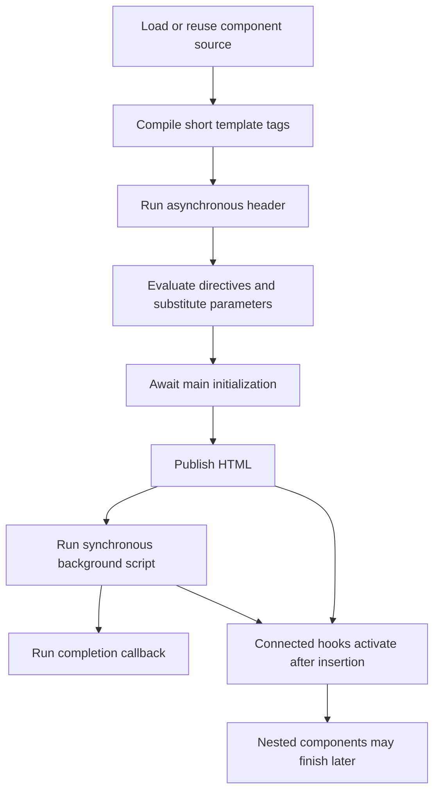

# Runtime structure

`dyHTML/ophtml.js` is the complete browser runtime. Its internal layers live in
one ES module, so development and deployment require no compilation, bundling,
generated distribution, or additional runtime files. The two older dyHTML/dyStyle
files remain reference implementations.

| Layer | Responsibility |
| --- | --- |
| `createRuntimeState` | Preserve the existing engine arrays, counters, configuration, and caches |
| `componentState` | Own component records, child relationships, retained references, pending mounts/requests, and cleanup callbacks |
| `templateApi` / `compileTemplateTags` | Parameter substitution, expressions, hash directives, and short-tag compilation |
| `renderingApi` / `renderComponentTemplate` | Coordinate loading, headers, initialization, output, background scripts, and completion |
| `controllerApi` | Implement repeaters, switches, loaders, and inline-content DOM operations |
| `domApi` | Select and extract DOM content |
| `requestApi` | Preserve callback-based XMLHttpRequest download/upload behavior |
| `trustedScripts` | Contain the runtime's executable-JavaScript boundary |
| `legacyApi` / compatibility installers | Preserve old convenience names, globals, string helpers, and constructor aliases |
| `opStyle` / motion helpers | Generate CSS utilities and control animations |
| `OpElement` subclasses | Activate generated hooks after connection and report asynchronous errors |
| `installRuntime` | Install globals, register elements, and install base animation/visibility CSS |

The public `dy.prototype` facade composes these layers. Existing public names
remain available, including `cacheComopunents`, `selectMuli`, and `init_page`.
Historical spellings stay at the compatibility boundary; new internals and
lifecycle APIs use descriptive names. The default export remains exactly
`{ html, script, style }`.

## Rendering lifecycle

`render()` returns an HTML string. It does not await a complete mounted subtree.
`renderElement()` prepares a controller and replaces the target contents only
after its own rendering succeeds. Connected hooks wait for their component's
synchronous background code. Tests inspect actual inserted DOM when checking
nested components.

Pending detached `renderElement()` controllers are associated with their intended
mount targets. Unmounting that target cancels pending framework loads and prevents
late insertion. Generated controllers check that their component is still active
before committing asynchronously prepared content.

## Ownership and cleanup

Each managed component has an internal record. Child component loads establish
ownership without changing the legacy meaning of render parameters. Owned
temporary-object and repeater indexes are tracked individually; disposal deletes
their entries without shifting indexes used by other live components.

- `onDispose(tid, callback)` registers resource cleanup and returns an unregister function.
- `dispose(tidOrElement)` releases managed state and descendants, retaining the DOM.
- `unmount(element)` performs disposal and clears the element, including when cleanup rejects.
- `isDisposed(tid)` is true for disposing, disposed, or unknown component IDs.

Disposal marks all selected components inactive synchronously. Cleanup runs
asynchronously, descendants before parents, with callbacks in reverse registration
order. Callback failures do not stop other cleanup or reference release; the
returned promise rejects with an `AggregateError` afterward. Concurrent disposal
waits for already-running cleanup and does not invoke callbacks twice.

Application timers, listeners, subscriptions, and asynchronous work must register
their own cancellation callbacks. Component-source and bounded placeholder-pattern
caches remain available for reuse. Array lengths are historical index ranges, not
counts of live components.
State objects retained by application code keep their fields and descriptors;
disposal removes the engine's references rather than erasing application data.

For HTML inserted manually from `render()`, retain `data.TID` using the third
argument `true` and dispose by that ID. A plain string's insertion destination
cannot always be inferred, especially when it contains no generated controller.
Explicit lifecycle calls preserve existing manual-DOM workflows; replacing
`innerHTML` alone does not perform automatic cleanup.

## Errors and compatibility

Rendering and native-hook errors retain existing Error types and messages, with
an `error.ophtml` context containing the relevant `phase`, `tid`, `page`, and `url`
when available. Errors thrown as non-Error values are normalized to Error objects.
Cleanup failures during failed rendering are available as `error.cleanupError`.
Native-hook failures also emit the existing bubbling `ophtml-error` event.
Intentional disposal cancels pending rendering with an `AbortError`; cancellation
is not emitted as a native-hook failure.

Expression evaluation restores its temporary global context even after failures
and nested synchronous evaluations. Global aliases and native string-prototype
extensions are still installed for backward compatibility, through the isolated
compatibility installers. Templates still execute trusted JavaScript and interpolate
raw HTML; this refactor does not introduce a sandbox or change CSP requirements.

See [API](api.md), [templates](templates.md), and the runnable
[lifecycle example](../examples/lifecycle/index.html).
